<div align="center">



<br>

<a href="LICENSE"></a>


<br><br>

<b>✨ Welcome to AeroSplice! ✨</b><br>
<sub>A small dockerized web app for <b>splicing</b> audio clips together and <b>extracting</b> audio from video/audio files, powered by ffmpeg.</sub>

<br><br>

<table>
<tr>
<td align="center" width="33%">🫧<br><b>Glossy &amp; bubbly</b><br><sub>Vanilla HTML/CSS/JS with a Frutiger Aero look: sky, glass, gloss, bubbles, grass.</sub></td>
<td align="center" width="33%">🔒<br><b>Your files stay put</b><br><sub>ffmpeg runs <b>in the browser</b> via <a href="https://github.com/ffmpegwasm/ffmpeg.wasm">ffmpeg.wasm</a>, so nothing is uploaded.</sub></td>
<td align="center" width="33%">🌐<br><b>Server fallback</b><br><sub>A small Python (FastAPI) server hosts the page and keeps a server-side ffmpeg API as a fallback.</sub></td>
</tr>
</table>

</div>


##  Run

```bash
docker compose up -d --build
```

Open <http://localhost:8000>, then splice away. 🎶


##  Features

### 🎚️ Splice clips

- Drop in any number of clips, reorder by drag-and-drop or ▲/▼, preview each one.
- Optional per-clip trim (`from` / `to`); the ◷ button grabs the current preview position.
- **Original (lossless copy)** uses the concat demuxer, exactly like doing it by hand:
  ```bash
  printf "file '%s'\n" p1.m4a p2.m4a p3.m4a > list.txt
  ffmpeg -f concat -safe 0 -i list.txt -c copy merged.m4a
  ```
  This needs every clip to have the same codec, sample rate and channel count. If they don't, the app tells you so.
- Any other format (MP3, M4A/AAC, Opus, Ogg Vorbis, FLAC, WAV) re-encodes through ffmpeg's `concat` filter, which handles mixed inputs, e.g. `-c:a libmp3lame -b:a 96k merged.mp3`.

### 🎬 Extract audio

- Pull the audio track out of a video (or audio) file, optionally only a start–end range.
- Stream-copy it (the container is picked to match the codec, e.g. AAC → `.m4a`) or re-encode it.

Each panel can show the equivalent ffmpeg command.

> [!TIP]
> Times can be written in seconds (`75.5`) or clock format (`1:15.5`, `1:02:03`).


##  Stays in your browser

- Processing runs in ffmpeg.wasm (single-threaded core, ~32 MB, downloaded once and then cached). Inputs are read straight from your files rather than copied into wasm memory, but the output is built in memory, so very large results (around 2 GB) won't fit.
- Opus is encoded with ffmpeg's built-in `opus` encoder in the browser, because the wasm build's `libopus` crashes on stereo input.
- Your clips, trims, settings and last results are kept in IndexedDB and come back after a reload.
- If the wasm build can't be loaded, the app falls back to uploading to the server's API.


##  Configuration

Set these environment variables in `docker-compose.yml`:

| Variable        | Default | Meaning                                  |
|-----------------|---------|------------------------------------------|
| `MAX_UPLOAD_MB` | `1024`  | Total upload size limit per request      |
| `MAX_FILES`     | `50`    | Max clips per splice                     |

These only apply to the server fallback / API. Its uploads go to a tmpfs (`/tmp`, 4 GB) and are deleted once the response has been sent.


##  API

The browser doesn't need these, but they're handy for scripting (and are the fallback when ffmpeg.wasm is unavailable).

| Endpoint | Body |
|----------|------|
| `POST /api/splice`  | multipart: `files` (repeated, in order), `trims` (JSON list of `{start, end}`), `format`, `bitrate`, `output_name` |
| `POST /api/extract` | multipart: `file`, `start`, `end`, `format`, `bitrate`, `output_name` |
| `GET /api/config`, `GET /api/health` | — |

```bash
curl -F files=@p1.m4a -F files=@p2.m4a -F format=mp3 -F bitrate=96k \
     -o merged.mp3 http://localhost:8000/api/splice
```


##  Local dev without Docker

Requires `ffmpeg` on your PATH (for the API) and `npm` (to fetch the ffmpeg.wasm build into `frontend/vendor/`, which is git-ignored; the Docker build does this itself).

```bash
scripts/vendor-ffmpeg-wasm.sh
cd backend
pip install -r requirements.txt
uvicorn app.main:app --reload
```


<div align="center">


<sub>Best viewed in any browser at 1024×768 or higher · Released under the <a href="LICENSE">MIT License</a> · © 2026 Furkan Arslan</sub>

</div>
